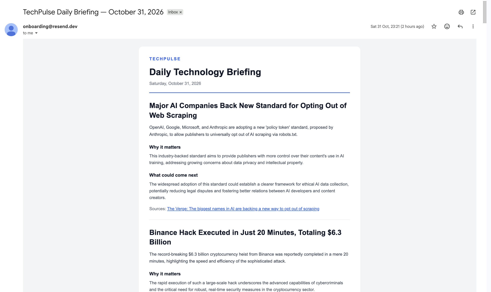

# TechPulse

TechPulse is an AI-powered technology intelligence platform that automates the process of discovering, analyzing, and summarizing technology news into a personalized daily email newsletter.

It uses RSS feeds to collect articles, Google Gemini to analyze and rank important stories, Supabase to manage data, and Resend to deliver newsletters directly to your inbox.

## Preview



## Tech Stack

- Node.js
- TypeScript
- Google Gemini API
- Supabase
- Resend
- RSS Feeds
- macOS LaunchAgents

## Local commands

```sh
npm ci
cp .env.example .env
# Edit .env privately and verify account protections before setting TECHPULSE_FREE_TIER_CONFIRMED=true
npm run collect
npm run process:ai
npm run newsletter -- --status
npm run newsletter -- --preview
# Only run --send after explicitly approving a real email
npm run newsletter -- --send
```

I wrote up the full journey here: https://techpulse-news.surge.sh/

